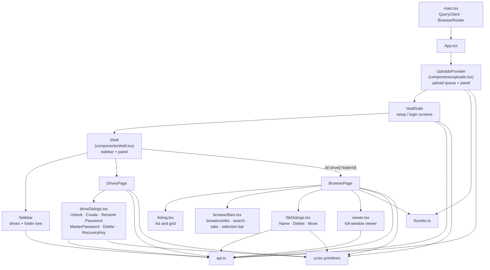
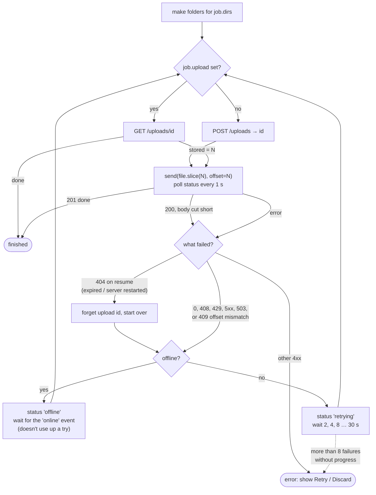

# Frontend modules

React 19 + TypeScript, built with Vite and styled with Tailwind CSS 4.
Source in [frontend/src](../frontend/src).

| Library | Used for |
|---|---|
| `@tanstack/react-query` | All server data: fetching, caching, invalidation |
| `react-router-dom` | Routes `/`, `/d/:drive`, `/d/:drive/:folderId` |
| `lucide-react` | Icons |
| `@fontsource-variable/geist` | The UI font, bundled (the CSP allows no third-party origins) |
| `mediabunny` (with `@mediabunny/ac3`, `dts`, `truehd`) | Takes MKV, WebM, MP4 and MOV apart for the video player; loaded when a video is opened, each decoder only when a track needs it |
| `mpegts.js` | Plays `.ts`/`.m2ts` video through Media Source; loaded only when one is opened |

The browser never holds a key. It sends passwords to the server, gets a
session cookie back, and from then on sees only decrypted names and file
bytes that the server streams to it.

## Component tree

`UploadsProvider` sits **above** `VaultGate` and the router, so uploads keep
running while you move between folders and drives.

## React Query keys

Every server read goes through React Query. Keys are arranged so one
invalidation refreshes everything affected:

| Key | Data | Invalidated / removed when |
|---|---|---|
| `["vault"]` | `GET /vault` (set up? unlocked?) | Login, logout, and any response saying `locked: "vault"` |
| `["drives"]` | `GET /drives` | Drives created, renamed, deleted, locked, password changed |
| `["nodes", drive, parent]` | One folder listing | Any change in that drive (`["nodes", drive]` prefix) |
| `["nodes", drive, "search", q, scope]` | Search results | Same prefix, so results refresh with the folder |
| `["info", drive, id]` | A file's details | Never refetched (`staleTime: Infinity`); updated in place by whatever learns more |
| `["webdav", drive]` | `GET /drives/{name}/webdav` | Set in place when WebDAV is turned on or off |
| `["zip", drive, id]` | A zip's entry list | Never refetched; dropped with everything else when the vault locks |
| `["zipPage", drive, id, path]` | One decompressed image from a comic or zip | Garbage-collected 30 s after it leaves the screen |
| `["zipStart", drive, id, path]` | Where a stored video's data starts in its zip | Never refetched |

Uploads and **Make thumbnails** change one file after another, so they refresh
the listings through `refreshSoon()` (`refresh.ts`): at once, then at most
every 1.5 s, rather than fetching a long folder again for each file.

Queries do not retry 4xx answers (a locked drive won't unlock itself) and
are fresh for 5 s.

When the vault is locked (logout, idle timeout, server restart), every
query except `["vault"]` is removed, so nothing decrypted stays in memory.
Locking or leaving one drive removes `["nodes", drive]` and its thumbnails.

---

## main.tsx and App.tsx

`main.tsx` creates the `QueryClient`, registers the vault-locked handler
(`setVaultLockedHandler` → invalidate `["vault"]`), and renders. `App.tsx`
declares the routes, all inside `Shell`; unknown paths redirect to `/`.

## Look and layout

Colours are CSS variables in `index.css`, each a `light-dark()` pair: neutral
greys (`shell`, `paper`, `surface`, `ink`, `muted`, `line`), plus `accent` for
what is selected, focused or in progress, `brass` for what is locked, and
`danger`. `theme.ts` keeps the choice of System, Light or Dark (Settings →
Appearance, `tgdrive.theme`) by setting `data-theme` on `<html>`, which sets
`color-scheme`.

Rules that keep the layout from breaking:

- **Size by container, not window.** `Page` is a container, and everything in
  it uses container variants (`@2xl:`, `@max-md:`). The sidebar and the
  details panel take their share of the window, so its width says little
  about the room there is.
- **Bars are one row.** The top bar (56px), the tabs and sort bar (48px) and
  the selection bar never wrap: labels give way to icons, tabs scroll
  sideways, breadcrumbs fold into a menu.
- **Nothing that comes and goes takes room.** The selection bar, progress and
  messages float in the `Dock`; the thumbnails button sits in a line whose
  height is fixed.

## components/shell.tsx

`Shell` is the layout route: the `Sidebar` and the panel the page is drawn in.
From the `lg` breakpoint up the panel scrolls inside the window; below it the
window scrolls and the sidebar is a drawer (a modal `<dialog>`). `Page` is the
scrolling part, `Topbar` sticks to its top, and `Dock` floats over its foot,
sharing its height as `--dock` so the uploads panel sits above it. `Toast` is one
message in the dock. The master password dialog lives here too.

## components/menu.tsx

`Menu`, `MenuItem` and friends. An open menu is a `popover` in the browser's top
layer, so no scrolling panel, sticky bar or dialog clips or covers it. It opens
upwards where there is more room, closes when anything scrolls, and takes
the keyboard (arrows, Home, End, Esc) while open, so the page's shortcuts don't fire.

## api.ts

The typed client. `request()` wraps `fetch` for JSON calls and turns every
failure into an `ApiError` with:

- `status`: the HTTP status, `0` for "can't reach the server", `-1` for
  "cancelled by the user".
- `locked`: `"vault"`, `"drive"` or `null`, from the 401 body.
- `message`: the server's `detail`, capitalised, or a fallback.

Any response with `locked: "vault"` also fires the vault-locked handler, so
an expired session anywhere sends the app back to the login screen.

`api` has one method per endpoint. `fileUrl` and `thumbnailUrl` build URLs
for `<a href>`, ``, `<video>` and `fetch`, which carry the cookie
automatically.

`sendUpload()` uses `XMLHttpRequest` rather than `fetch`, because only XHR
reports upload progress. It returns the promise and an `abort()` function.

## components/VaultGate.tsx

Nothing below it renders until the vault is unlocked. It reads `["vault"]`
and shows one of:

- **SetupScreen** (not initialized): choose the master password, plus the
  admin password if the server requires one. Then shows the recovery key
  once in `RecoveryKeyDialog`.
- **LoginScreen** (locked): master password, or switch to "Forgot the
  master password?" to reset it with the recovery key.
- the app (unlocked).

`useLockEverything()` logs out, drops decrypted thumbnails, removes all
cached queries and refetches the vault status.

## components/uploads.tsx

The upload queue, its retry logic, and the floating progress panel. The
most involved part of the frontend. While anything is uploading, the tab's
title shows the overall percentage too (`42% uploaded · tgdrive`), counted as
the panel does (`tally()`).

**Input.** `pickedFromInput()` handles the file and folder pickers (folder
paths come from `webkitRelativePath`). `readDropped()` walks dropped
folders with the File System Entries API (`webkitGetAsEntry`,
`readEntries` in batches) and returns files with their folder path, plus
empty folders.

**Queue.** `enqueue(drive, parent, files, emptyFolders)` adds one `Job` per
file or empty folder. All jobs from one drop share a `Batch`, whose
`folders` map caches the id of each folder created, so a 1,000-file drop
creates each folder once (`createFolder(..., exist_ok=true)`).

**Already uploaded.** First, `alreadyThere()` lists the folders the files
would go in (only those that exist) and finds the files already there with
the same name and size; files this tab already has queued for the same place
count too. If there are any, `SkipDialog` asks whether to skip them and
upload the rest, rather than letting the server refuse each one. A file of
the same name but another size isn't the same file: it is sent, and fails
with "already exists". If the check itself fails, everything is queued.

**One file at a time, across devices.** Telegram rate-limits bots per chat,
so parallel uploads would trade speed for retries. Every tab reports its
rows to the server's shared upload line (`POST /uploads/sync`, see
[uploadqueue.py](backend.md#uploadqueuepy)) once a second while anything is
going (every 3 s otherwise), sending only rows whose object changed since
the last sync. The answer carries other tabs' rows, which the panel shows
in line order with a "Another tab or device" note; they can be cancelled
from here (the owning tab sees `cancel` and stops) but not retried. `pump()`
runs the next job only when none is running here and nothing ahead of it
in the line is still going, so a new upload queues behind whatever another
device is sending. Enqueuing, retrying and finishing a job sync at once
rather than waiting for the next tick; closing the tab sends
`/uploads/leave` with `sendBeacon` so the next device need not wait for the
server to time this one out.

**Resume and retry.** `run(job)` loops:

The failure counter resets whenever `stored` has moved forward, so a long
upload over a flaky connection keeps going as long as it makes progress.

**Progress.** The bar shows two layers: bytes the browser has **sent**
(light) and bytes **stored** in Telegram (solid), from polling
`GET /uploads/{id}` once a second. Speed is a moving average: 5 s while
sending, 20 s while the server is storing (it moves 16 MiB at a time).
When the server reports a `wait`, the row says why ("Telegram asked to slow
down. Trying again in 12 s.").

**Time taken.** The header counts only the time something was going
(`clock`: it stops whenever nothing is queued or uploading, and picks up
again when more files are added), showing "4 min so far" and, once done,
"took 6 min". The overall average speed is worked out from the same time.

**After an upload**, `sendDetails()` makes a thumbnail and reads the
file's details from the local copy in the background while the next file
starts.

The chevron in the panel's header folds the list away, leaving the header
with the overall progress (even for one file) and a count of failed or
unfinished rows; the choice is remembered in `localStorage`. Failed rows sit
below the list in a section of their own (`Failures`), folded down to a count
until opened, so the upload in progress stays in view.

While this tab is sending anything, a `beforeunload` handler asks before
the tab is closed. Failed jobs are kept so **Retry** resumes from where they stopped;
**Discard** cancels the upload on the server, freeing its name.

## thumbs.ts

**Loading.** `loadThumbnail(drive, id)` fetches
`/files/{id}/thumbnail`, turns it into an object URL, and caches it in a
`Map` for this tab only (the server sends `no-store`, so decrypted
thumbnails never reach the disk cache). `slot()` limits how many run at
once, to leave browser connections free for navigation: 3 to show
thumbnails, 3 to make them, 5 in all, showing first. A 404 is remembered as
"no thumbnail"; other failures are retried later. `forgetThumbnails(drive?)`
revokes the URLs.

HEIC/HEIF counts as an image (`isConvertedImage` in format.ts): the server
makes its thumbnail, and the viewer shows `api.previewUrl`, a JPEG the
server converts, instead of the file itself.

`hasThumbnail(entry)` says whether asking can succeed: the server says it
has one, or it is an image of 50 MB or less (which the server can make on
demand).

**Making.** After an upload, `sendDetails()` draws an image, a video
frame at `frameTime()` (a tenth of the way in, at least 3 s and at most
3 min, never past halfway), or a comic's (.cbz) first page in name order,
read from the zip's index with `zip.ts` (which takes a local `Blob` as
well as a URL), or audio's cover art, read from its tags with
`player/cover.ts` (Mediabunny: MP3, FLAC, M4A, Ogg, WAV), or a PDF's first
page, drawn by `pdf/` ([below](#pdf)), onto a canvas scaled to 320 px and `PUT`s it
as WebP (PNG where WebP encoding is unsupported). The server re-encodes
whatever it receives. This means Telegram is never asked for a file just to
thumbnail it.

A file opened in the viewer without one gets one: `sendPicture()` from the
image shown, `sendPdfPage()` from a PDF fetched whole (up to 200 MB), `sendVideoFrame()` from a hidden second player seeking to
`frameTime()` (so it doesn't matter where the user is watching), or, for
MPEG-TS, `sendFrame()` from the player once it gets there.
`regenerateThumbnail()` (**Regenerate thumbnail** in a file's menu) deletes
it on the server and makes a new one with `makeThumbnail()` (below): an
image up to 50 MB on the server, so the browser downloads nothing. `useThumbnailVersion()`
lets anything showing the old one load the new one.

**Make thumbnails** under a folder's name (with how many it lacks) runs `makeThumbnail()` on each image,
video, comic, PDF and audio file there without one, `MAKE_PARALLEL` (3) at a time. Images the server can thumbnail
(up to 50 MB) are left to it, so the browser doesn't download them; larger
ones, videos, comics, PDFs and audio are drawn from the server's copy, a video read only as far as its
frame (`preload="metadata"`), a comic or PDF only its index and first page (which the server fetches together:
`api.fileUrlAhead`), audio only its tags. Audio found to have no cover art is
remembered for as long as the tab is open (`hasNoCover()`) and not looked at again. An `AbortController` stops it when the folder,
drive or search changes; closing the tab stops it anyway. Files whose
thumbnail is cached on the server count as having one, and the server sends
those to Telegram itself.

In the listing, a thumbnail is asked for once its row has been drawn for
100 ms, so scrolling fast through a long folder doesn't queue up all it
passes. Thumbnails are fitted inside their box (`object-contain`),
and a video's, comic's, PDF's or audio file's carries a small badge (`KindBadge`) so it isn't
mistaken for a picture.

The same decode yields the file's details (dimensions, length, EXIF date
and camera, last-modified time), sent with one `PUT /files/{id}/info`.

## pdf/

`firstPage()` (`page.ts`) draws a PDF's first page in a worker of its own
(`worker.ts`), which runs PDFium (`@embedpdf/pdfium`, WebAssembly, loaded only
then) and ends with the page, or after 60 s (20 s for a local copy).

A PDF ends with its index, so the start of the file is rarely enough: PDFium
asks for the bytes it needs, synchronously, and the worker answers with range
requests (synchronous `XMLHttpRequest`) or slices of the local copy, a
mebibyte at a time, more when it reads on. A large PDF usually costs the
server two chunks from Telegram, the first and the last, fetched together
(`api.fileUrlAhead`), plus the one with the first page if it is elsewhere.
(pdf.js isn't used because it loads every page's entry, often spread over the
whole file, to open one.)

There is no thumbnail if it needs a password, is damaged, is 2 GiB or more, or
would take more than 64 MiB to draw (PDFium searches a damaged file from end to
end), nor if any read failed, as the page would have holes in it.

## fileinfo.ts

File details are only ever gathered for free: from the local copy while
uploading, from a preview already on screen, or by the server while making
an image thumbnail. Nothing downloads a file just to describe it.

`useFileInfo(drive, entry)` reads `GET /files/{id}/info` (database only).
`useLearn(drive, id)` returns a function that previews call with what the
media element found (`naturalWidth`, `videoWidth`, `duration`); it sends
only fields that differ from what is cached. `readExif(file)` parses the
date taken and camera from the first 256 KB of a local JPEG.

## format.ts

Formatting and shared constants: `formatSize`, `formatDate`,
`formatDuration`, `formatLength` (media length), `formatDateTime`,
`typeName(name, size)` ("JPEG image"), `previewKind(name, size)` (image, video, audio, pdf, text,
archive, comic or none, by extension; `.ts` over 1 MiB counts as video, smaller as TypeScript),
`isTransportStream(name)`,  `PASSWORD_MIN = 8`, `DRIVE_NAME` (same pattern as the
server), and `driveUrl(drive, folderId)`.

## pages/DrivesPage.tsx

The home page: every drive as cards or a list, with a lock dial showing
whether it is unlocked. Opening a locked drive shows `UnlockDialog`.
A drive's menu offers lock, rename, add/change/remove password, WebDAV
access, and delete; drives with WebDAV on carry a tag.

If `BrowserPage` finds its drive locked (session idle, locked elsewhere), it
navigates here with `state: { unlock, from }`. The page opens the unlock
dialog straight away and returns to the folder afterwards. The sidebar uses
the same way in: `{ unlock }` for a locked drive, `{ create: true }` for its
create button.

## pages/BrowserPage.tsx

The file browser for one drive and folder.

- **Listing**: `["nodes", drive, parent]`, as a list or grid (remembered in
  `localStorage`), drawn by `components/listing.tsx`. A whole row opens its
  item. In the grid, folders at the front are small tiles and the rest get a
  thumbnail. Only the rows in or near view are drawn (`useVisibleRows` in
  `components/rows.ts`), with padding in place of the others, so a folder of
  thousands stays quick. Anything that needs an item's place on the page asks
  the listing for it (`ListingHandle`) rather than the DOM, where it may not
  be. The browser's own find in page sees only what is drawn; search finds
  the rest.
- **Bars** (`components/browserBars.tsx`): the top bar has breadcrumbs, search,
  the details toggle and the drive's menu. Upload files, Upload folder and New
  folder are cards at the top of the folder; once those scroll out of
  view the top bar offers an **Add** menu, and narrow pages have it floating.
- **Tabs** (`filters.ts`): one per sort of thing in the folder or the results
  (folders, images, videos, …), with counts. A tab narrows `entries`, so
  selection, keyboard and the viewer's stepping stay within it. It resets
  when the folder changes.
- **Sorting** (`sorting.ts`, `components/SortMenu.tsx`): by name (natural
  order, so `2` before `10`), type (extension), size or date added, either
  way, folders first or mixed in; ties fall back to the name. Done in the
  browser, so the viewer, keyboard moves and bulk-rename numbering follow the
  order shown. Chosen from the menu beside the view toggle or by clicking a
  list column (again to flip it); remembered for every folder in
  `localStorage` (`tgdrive.sort`). Search results stay ranked by relevance
  unless a sort is picked, which lasts until the search ends.
- **Search**: the query lives in the URL (`?q=`), debounced by 250 ms, so
  Back returns to the results. Results replace the folder listing and show
  each match's folder path. A search covers the open folder and everything
  below it (`scope`); the button beside the match count widens it to the
  whole drive (`?in=drive`), until the search is cleared or another folder
  opened. `/` focuses the box.
- **Selection**: click with Ctrl/Cmd to toggle, Shift for a range; once
  anything is selected, plain clicks select too. Ctrl/Cmd+A selects all,
  Esc clears, Delete/Backspace deletes, F2 renames (one item in
  `NameDialog`, several in `BulkRenameDialog`). The actions float in the
  dock (`SelectionBar`), whose menu also has **Select all**, **Invert
  selection** and, for one item, **Advanced rename**.
- **Keyboard**: a highlight (`cursor`, an entry id, outlined) is separate
  from the selection. Arrows move it (Up/Down by a whole row in the grid, to
  keeping to the column: `rowAway`), as do Home/End and
  PageUp/PageDown; Shift extends the selection from the anchor. Enter opens
  the highlighted item (`openEntry`: folder, preview or download), Space
  selects it, Backspace or Alt+↑ goes up a folder, and typing letters jumps
  to the next name starting with them (repeating one letter cycles). Delete
  and F2 act on the highlighted item when nothing is selected. Back in a
  parent folder, the folder just left is highlighted. Enter and Space are
  left to a focused button or link. `?` lists all of this (`ShortcutsDialog`).
- **Bulk rename**: `BulkRenameDialog` gets each item with its folder, and
  the names of the folder's other items (only known for the folder shown;
  for search results the server checks). After renaming, the dock offers
  **Undo**, which sends the old names back in one `renameMany`.
- **Actions**: new folder, upload files, upload folder, rename, move (one or
  many), delete (one or many), download, preview, lock drive. A folder,
  or more than one item, downloads as a zip (`downloadZip`: `api.createZip`,
  then a link click on the `url` it returns), named after the folder or
  the folder being shown.
- **Drag and drop**: files and folders dropped anywhere in the window go to
  `uploads.enqueue` for the current folder.
- **Opening**: folders navigate; previewable files open the `Viewer`;
  others download.
- **Details**: each item's menu has **Details**, which opens
  `DetailsDialog`. On wide screens the panel button in the top bar
  shows `DetailsPanel` (remembered in `localStorage`): the one selected item,
  totals for several, or the folder when nothing is selected.

## components/Sidebar.tsx

On every page, as part of `Shell`: every drive, with the folder tree of
unlocked drives, then **Lock tgdrive** and the settings (appearance, master
password) at the foot. It collapses to a rail of icons (`tgdrive.rail`). Folders load
lazily (`["nodes", drive, id]`, only when expanded), sharing the cache with
the main listing. Nothing opens on its own: only the arrows expand folders,
and the locate button beside "Drives" (shown inside a folder) opens the tree down
to the folder being viewed and scrolls it into view.
Clicking a locked drive goes to the drives page to unlock it. An unlocked
drive with its own password has a lock button on its row (on hover with a
mouse), which leaves the drive first if it is being viewed.

## components/driveDialogs.tsx

| Component | Does |
|---|---|
| `NewPasswordFields`, `checkNewPassword` | Password + repeat, minimum length |
| `UnlockDialog` | Drive password, or reset with the drive's recovery key |
| `CreateDriveDialog` | Name, and optionally a password |
| `RenameDriveDialog` | Renames the drive; the page that opened it then re-points queued uploads with `uploads.renameDrive` |
| `RecoveryKeyDialog` | Shows a recovery key once, with copy, and requires confirming it was saved |
| `DrivePasswordDialog` | Add, change or remove a drive password |
| `MasterPasswordDialog` | Change the master password |
| `DeleteDriveDialog` | Type the drive's password (or the master password) to delete it |
| `WebDavDialog` | WebDAV on or off for a drive. Turning it on (or making a new password) asks for the drive's password, or the master password, and a read-only choice, then shows the address, user name and generated password once. Warns when the page is on plain HTTP away from localhost. Reads `["webdav", drive]` |
| `CopyButton` | Copies text and says "Copied" for two seconds; used by the recovery key and WebDAV dialogs |

## components/fileDialogs.tsx

| Component | Does |
|---|---|
| `NameDialog` | New folder / rename |
| `DeleteNodeDialog` | Confirms deleting one or many entries |
| `MoveDialog` | Folder picker to move entries into |

## components/BulkRenameDialog.tsx and rename.ts

Renaming many items at once. `rename.ts` is pure: `plan(items, settings,
others)` runs an ordered list of rules over each name and says, per item,
the new name and what would stop it (empty, a slash, too long, two items
landing on one name, or a name already taken in the folder). The dialog
re-runs it on every change for the live preview (first 400 rows drawn,
changed part marked), and sends only changed names, in one
`api.renameMany`, which the server applies all or none.

| Rule | Does |
|---|---|
| Find and replace | Plain text or regular expression (`$1`, `$<name>`, `$&`), match case, whole words, first or every match |
| New name from pattern | The name from tokens; keeps the extension unless the pattern uses `{ext}` or `{full}` |
| Insert text | At the start, the end, or a position from either end |
| Remove characters | First N, last N, or N from a position |
| Number | Start, step, padding (or fit the largest), 1/a/A/I styles, before, after or instead of the name |
| Change case | Title, sentence, lower, upper, swap, camel, Pascal, snake, kebab |
| Clean up | Trim, collapse spaces, `_`/`.` to spaces, drop bracketed text, strip accents, spaces to `_`/`-`/`.` |
| Extension | Lower, upper, change or remove (the name only; nothing is converted) |

Most rules can work on the name, the extension, or both. Text fields take
tokens: `{name}`, `{ext}`, `{full}`, `{n:pad:start:step}`, `{count}`,
`{parent}`, `{date}` / `{taken}` / `{modified}` / `{created}` (each with an
optional format such as `{date:YYYY-MM-DD}`), `{width}`, `{height}`,
`{duration}`, `{camera}`, `{size}`, and `|upper`, `|lower`, `|title`.
Tokens needing file details fetch `["info", drive, id]` only when used.
Numbering follows the list, name (natural order), date, upload date, size
or type, optionally reversed and restarting in each folder.

Rules can be turned off, reordered, duplicated and removed. The last rules
used are remembered in `localStorage` (`tgdrive.bulkRename`), and named
presets under `tgdrive.bulkRename.presets`.

## components/viewer.tsx

`Viewer` is a full-window `<dialog>` that steps through the previewable files
of the listing (or search results) it was opened from.

- **Header**: name, size, "3 of 12", Details toggle (`i`; the panel is
  `EntryDetails`, remembered in `localStorage`), Download, Close (Esc).
- **Stepping**: ← / → buttons and keys, and a horizontal swipe on touch
  screens for images, audio, comics and zips. Keys are left alone while a
  media element has focus, so its own seeking keys still work. The video
  player takes the arrows too; Shift+← / → steps past it. `[` / `]` always
  go to the previous or next file, whatever is open: past a video's seeking
  and a comic's remaining pages, even with a video focused.
- **Full size**: what is shown takes all of the window but the header, scaled
  up if it is smaller.
- **Controls fade** (`useIdle`): a reader's page bar and the player's controls
  fade out 2.5 s after the pointer last moved, and come back when it moves or
  is tapped. They stay while the pointer rests on one (anything marked
  `data-control`) or one has keyboard focus. The ← / → buttons appear only
  while the mouse is over them; without a mouse, or in a narrow window, they
  fade like the rest (the `mouse:` variant in `index.css`).
- **What it shows**: images, video, audio and PDF (iframe) through
  `?inline=true`, which the server honours only for safe types. Video has
  its own player ([below](#componentsplayertsx-and-player)). Text fetches
  the first 512 KB with a `Range` request. Files the browser can't decode say so and offer the
  download.
- **Zips** (`zip`, `jar`, `apk`): `listZip()` in `zip.ts` reads the
  last 64 KiB (the end record and usually the whole central directory), and
  the directory itself if it starts earlier; ZIP64 adds at most one more
  read. So listing costs the server one or two chunk fetches from Telegram,
  however large the archive. Entries are shown as folders you can step
  into, with sizes, dates and a lock on encrypted entries. If the zip holds
  images or videos, "View N items" (or clicking one) opens them in the same
  reader as comics. A zip always opens on its list.
- **Comics** (`cbz`): the same index gives the page images (sorted by name,
  skipping `__MACOSX` and dot files). `readZipEntry()` fetches one page with
  one range request and inflates it with the browser's
  `DecompressionStream("deflate-raw")`, so the file is never downloaded
  whole. Two pages are read ahead once the current one is in. Arrow keys,
  swipes and tapping either half of the page turn pages, and only move to
  the next file past the last page. A slider jumps anywhere. The page
  reached is remembered per file in `localStorage`. Page images are cached
  as `["zipPage", drive, id, path]` for 30 s after they leave the screen.
- **Reading modes** (remembered in `localStorage` as `tgdrive.readMode`):
  one page at a time, or scrolling down through every page, with gaps or
  without (for webtoon-style strips). Scrolling loads only the pages within
  a screen's height of the view (`IntersectionObserver`); the rest keep the
  shape they had, or the first known page's, and the browser's scroll
  anchoring keeps the view still as they load. The page a third of the way
  down the screen is the current one; ← / → jump a page.
- **Videos in zips**: a stored (uncompressed) entry is a plain byte range
  of the zip. `zipEntryStart()` reads its local header to find where, and
  the video plays from `/files/{id}?offset=…&length=…&filename=…`, which
  the server serves as a file of its own, ranges and all, so it streams and
  seeks. A deflated entry is unpacked whole into a blob first, with
  progress; past 256 MB, or while scrolling, only when asked.

## components/player.tsx and player/

`VideoPlayer` draws its own controls: a seek bar that shows what is in
memory, how many seconds are buffered, volume, subtitles, audio track, speed,
picture in picture and full screen. Keys while it has focus: Space or `k`,
← / → (5 s), `j` / `l` (10 s), ↑ / ↓ (volume), `m`, `c` (next subtitle), `f`,
Home, End. Dragging the seek bar seeks once, where it is let go. Volume and the
language last chosen for sound and for subtitles are kept in `localStorage`.

There are three ways a video reaches the `<video>` element:

| Way | For | Read-ahead limited by |
|---|---|---|
| Engine | MP4, MOV, MKV, WebM whose video codec Media Source takes | `engine.ts` |
| mpegts.js | `.ts`, `.m2ts`, `.mts` | Its `lazyLoad` options: 60 s |
| `<video src>` | Whatever those can't play | The browser |

When one fails as unplayable, the last is tried from the same place. A network
failure isn't that: it shows "Try again".

**engine.ts.** Browsers play only a file's first audio track and decide
themselves how much to read ahead. So the file is taken apart with Mediabunny
and the chosen tracks are appended to Media Source buffers, one `Feed` each.
Reading ahead stops at 60 s or 64 MB, whichever comes first (but not under
10 s), and at 1 s before playback is first asked for. About 20 s behind the
playhead is kept, cut at a keyframe. A browser whose quota is smaller gets less.
Changing the audio track restarts only the audio feed, then seeks to the same
place: otherwise Chrome joins the new track onto decoded frames of the old one,
up to 85 ms out.

**bytes.ts.** Range requests in 1 MB blocks, growing to 16 MB when reading on
(one Telegram chunk), keeping the last 48 MB. Seeking drops requests
nobody is waiting for. Failures are retried three times.

**fmp4.ts** writes the fragments; Mediabunny makes the header. Its own
fragments run from keyframe to keyframe, which can be ten seconds.

**Audio the browser can't play** (AC-3, E-AC-3, DTS, TrueHD, PCM, ...) is
decoded with WebAssembly, mixed down to stereo, and passed on as FLAC
(`flac.ts`). WebCodecs could encode Opus, but exists only over HTTPS.

**Subtitles** are drawn over the picture from cues: SubRip, WebVTT, ASS/SSA
(line breaks, bold, italic, alignment and position; no colours, fonts or
karaoke) and MP4 timed text. `mkv.ts` and `mp4.ts` read embedded tracks from
the stretch of file just fetched for the picture, so nothing more is
downloaded. Files next to the video (`Film.srt`, `Film.en.srt`) are offered
too. Picture subtitles (PGS, VobSub) are listed but can't be shown.

## components/ui.tsx and LockDial.tsx

Small shared pieces: `Button`, `Field`, `ErrorNote`, `Dialog` (native
`<dialog>`), `Menu`/`MenuItem`, `PageHeader`, `ViewToggle` and
`useSavedView`, and `useSubmit()` (busy and error state for a form action).
`LockDial` is the combination-lock icon whose knob turns when a drive is
unlocked.

## index.css

Tailwind entry point plus the colour tokens (`--paper`, `--surface`,
`--ink`, `--muted`, `--line`, `--teal`, `--brass`, `--danger`) used across
the components, with a second set for dark mode.
